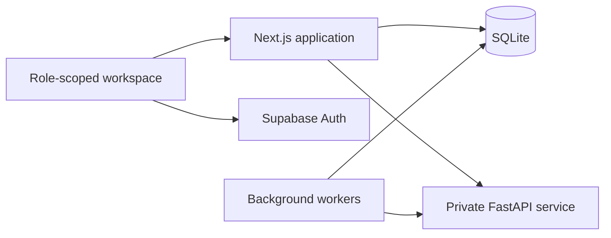

# VIDYA
### APAAR-based Student Data Management & Verification Platform

A working prototype for **Smart India Hackathon problem SIH26263**, designed around how institutions submit student records, officers review discrepancies, and students control access to their information.

**Synthetic data only.** VIDYA uses a mock APAAR registry and illustrative institution approvals. It is not an official AICTE, APAAR or Government of India service.

[Features](#features) · [Roles](#roles-and-access) · [Quick start](#quick-start-windows) · [Demo](#suggested-demo) · [Documentation](#documentation)

## The problem

Student data submitted across institutions can contain inconsistent identity details, duplicate admissions and intake violations. Verification also needs clear ownership: who submitted a record, who approved it, which version was signed, and what a verifier is allowed to see.

VIDYA brings those steps into one role-scoped workflow.

## How it works

1. **Sign in and request access.** New accounts request a role and scope; an authorised reviewer approves access. Returning users open their assigned workspace.
2. **Upload and correct records.** Institution operators upload CSV/Excel files, inspect row-level findings and correct errors.
3. **Review and sign off.** Institution Heads review submissions. Revisions retain versions and reasons for changes.
4. **Review institutional risk.** Officers inspect dashboards, peer comparisons and anomaly evidence before recording decisions.
5. **Share with consent.** Students approve selected fields for a verifier, reject a request or revoke access.
6. **Issue and check certificates.** Eligible approved records receive signed certificates with QR links to a public integrity check.

Each role has a guided checklist with links to its main tasks. Checklist progress is a personal reminder, not evidence that an approval or transaction has completed.

## Features

| Area | Implementation |
| --- | --- |
| Institution master | Institutions, programs, academic-year approvals, intake limits and separate supernumerary scheme caps |
| Upload Centre | Background CSV/XLSX parsing, row-level errors and warnings, corrections, provenance and version history |
| Identity validation | Mock registry adapter, 12-digit format and existence checks, fuzzy name matching and exact DOB comparison |
| Rules engine | Database-configured V01–V14 checks, including duplicates, intake, category consistency, dates and deadlines |
| Dashboards | National, regional and institution views; illustrative India map; intake/enrolment comparisons and drill-down |
| Anomaly Centre | Isolation Forest, institution-level features, peer comparisons, 0–100 risk scores and plain-English reasons |
| Review workflow | Officer notes, Cleared/Confirmed decisions and institution follow-up cases |
| Consent centre | Purpose-based requests, student-selected fields, approve/reject/revoke and time-limited access |
| Verifiable records | Ed25519 signatures, QR-linked certificates, PDF downloads and Valid/Tampered/Revoked checks |
| Audit and reports | Hash-chained audit events, integrity checks and scoped Excel/PDF exports |
| Workspace experience | White/navy/teal interface, English/Hindi controls and role-specific walkthroughs |

### Validation rules

| Rules | Checks |
| --- | --- |
| V01–V04 | Missing, malformed or unknown APAAR; name/DOB mismatch |
| V05–V07 | Duplicate within a file, institution or across institutions |
| V08–V09 | Within-intake excess and separate supernumerary scheme caps |
| V10–V11 | Category/nationality/passport consistency and date logic |
| V12–V14 | Unapproved program, late submission and possible duplicate person |

Within-intake and supernumerary admissions are counted separately. Anomaly scores prioritise investigation; they do not establish fraud. APAAR format coverage is distinct from registry confirmation.

## Roles and access

| Role | Main responsibilities and scope |
| --- | --- |
| Student | View the linked synthetic record and certificates; manage verification consent |
| Institution Operator | Upload and correct records for the assigned institution |
| Institution Head | Review/sign off submissions and review permitted access requests within the institution |
| AICTE Regional Officer | Inspect institutions, anomalies, reports and cases within the assigned region |
| AICTE Admin | National oversight, access management and rule configuration |
| External Verifier | Request information and view only student-approved fields while access remains valid |
| Degree-awarding Body | Issue/check certificates within the assigned scope |
| System Admin | Inspect technical readiness, delivery queues and audit operations |

Portal selection does not grant permissions. Server-side role and scope checks govern access. AICTE/system staff roles require administrator assignment.

## Technology

| Layer | Stack |
| --- | --- |
| Web application and API | Next.js 16, React 19, TypeScript |
| Interface | Tailwind CSS 4, Lucide icons |
| Authentication | Supabase Auth: Google and email |
| Application database | SQLite through Node.js |
| Validation and ML | Python, FastAPI, RapidFuzz, scikit-learn Isolation Forest |
| Synthetic data | Faker with the `en_IN` locale |
| Files and certificates | ExcelJS, PDF-lib, QRCode, Ed25519 signatures |

Supabase provides authentication. Application records, role assignments and workflow state are stored in the local SQLite database.



## Synthetic dataset

- **100 institutions** and **300 programs**.
- **5,000 synthetic students** and mock registry identities.
- **20,000 enrolment records** across 2023–2026.
- **1,200 program/year approvals**.
- Planted validation errors and four institutions with anomalous patterns.

These are demonstration fixtures, not real users, live adoption figures or measured production outcomes. Mock APAAR IDs are never submitted to an official registry.

## Quick start (Windows)

### 1. Requirements

- Git
- Node.js **24.9 or later** with npm
- Python 3 with support for the pinned packages in the requirements files
- A Supabase project with Google and/or email authentication configured

### 2. Clone and install

```powershell
git clone https://github.com/Ayushk1248/Vidya.git
cd Vidya
npm ci
py -m venv .venv
.\.venv\Scripts\python.exe -m pip install -r requirements-seed.txt -r requirements-validation.txt
Copy-Item .env.example .env.local
```

### 3. Configure local environment

Edit `.env.local` and supply your project's public authentication configuration:

```dotenv
NEXT_PUBLIC_SUPABASE_URL=https://YOUR_PROJECT.supabase.co
NEXT_PUBLIC_SUPABASE_PUBLISHABLE_KEY=YOUR_PUBLIC_PUBLISHABLE_KEY
PLATFORM_PUBLIC_ORIGIN=http://localhost:3001
VALIDATION_SERVICE_URL=http://127.0.0.1:8002
VIDYA_DEMO_MODE=0
```

The legacy `NEXT_PUBLIC_SUPABASE_ANON_KEY` is also supported. Use public browser credentials here; never put a secret/service-role key in a `NEXT_PUBLIC_` variable.

Configure Supabase redirect URLs and the Google provider as described in [Google sign-in](docs/GOOGLE_SIGN_IN.md) and [teammate setup](docs/TEAMMATE_SETUP.md). Do not overwrite an existing `.env.local` when updating a working checkout.

### 4. Initialise and run

```powershell
npm run init
npm run seed
npm run dev
```

Open **[http://localhost:3001](http://localhost:3001)**.

The single development command starts the web app, private Python service and background workers. Keep it running while testing. The seed command leaves an already seeded database unchanged.

### 5. Activate the first administrator

After a trusted administrator signs in once, the local project owner can bootstrap that account using its verified Supabase user UUID:

```powershell
npm run role -- YOUR_SUPABASE_USER_UUID aicte_admin
```

This is a one-time setup/recovery utility. Subsequent access requests are reviewed through **Access management**. Privileged workflows require the configured authenticator checks outside explicit local demonstration mode.

**Clones have separate application databases.** Sharing a Supabase project shares authentication identities; it does not synchronise local records or role approvals. Use one hosted application with persistent storage when the team needs shared workflow state.

## Suggested demo

Use separate browser profiles for simultaneous accounts.

1. Approve an Institution Operator/Head for **INST001**, a Student linked to **STU00001**, and an External Verifier.
2. Show the operator's upload findings and correction workflow.
3. Inspect institutional capacity and anomaly evidence from an authorised officer account.
4. Have the verifier request fields using mock APAAR **990000000001**.
5. Approve only some requested fields as the student; confirm the verifier cannot see the others.
6. Revoke consent or reject another request and confirm that access is blocked.
7. For a currently approved, eligible record, issue a certificate and open its public check link.

A historical seed sign-off flag alone is not sufficient for certificate issuance. Head approval email delivery needs working server-side SMTP configuration; local mock OTP behaviour is for explicit demonstration mode.

For an optional synthetic developer demo, follow [teammate setup](docs/TEAMMATE_SETUP.md). Demo setup modifies shared demo fixtures and is not a substitute for normal account approval.

## Security and boundaries

- Server-side RBAC and institution, region and student data scopes.
- Masked APAAR/passport displays and encrypted mobile, email and passport columns.
- Consent field filtering, expiry and revocation enforced on the server.
- Privileged authenticator sessions and rate limits on sensitive workflows; Supabase manages authentication rate limits.
- Ed25519-signed records and hash-chained audit events.
- Private validation service authenticated using an internal service token.

Keep `.env.local`, encryption/signing keys, uploaded files, backups and the SQLite database out of Git. Preserve the database and its encryption key together. Account deletion additionally needs a server-only Supabase administrative key; ordinary sign-in does not.

This is a functional prototype, not a production-certified identity service. Scheme caps and map boundaries are illustrative. External audit checkpoints strengthen detection of complete-chain rewriting or suffix deletion.

## Checks and production startup

```powershell
npm test
npm run test:validation
npm run typecheck
npm run build
npm start
```

Tests cover access scope, validation, intake counting, consent, certificates, audit integrity and workflow behaviour. Some checks require appropriate local service/environment configuration. External Google sign-in and email delivery also need manual end-to-end checks.

Production needs persistent storage, continuously running Node/Python processes and workers, HTTPS, backups, and production authentication/email settings. A serverless-only deployment is insufficient for the current architecture.

Set `PLATFORM_PUBLIC_ORIGIN` to the deployed HTTPS origin **before issuing certificates**. A QR containing `localhost` cannot open the laptop's website on a phone.

## Repository layout

```text
app/                  Pages and API routes
components/           Workspace UI and workflow components
lib/                  Platform services, access checks and UI utilities
db/                   Database schema
services/validation/  FastAPI validation and anomaly service
scripts/              Setup, seed, launchers and workers
tests/                Automated checks
docs/                 Setup, workflow and testing guides
data/                 Private runtime data (ignored by Git)
```

## Documentation

- [Teammate setup and shared/local deployment](docs/TEAMMATE_SETUP.md)
- [Google sign-in configuration](docs/GOOGLE_SIGN_IN.md)
- [Upload testing](UPLOAD_TESTING.md)
- [Anomaly testing and model assumptions](docs/ANOMALY_TESTING.md)
- [Certificate testing and QR limitations](docs/CERTIFICATES_TESTING.md)
- [Reports and export checks](docs/REPORTS_TESTING.md)
- [Implementation and demonstration guide](docs/PLAN_IMPLEMENTATION.md)

Built by **Team Byters** for the SIH26263 prototype.
